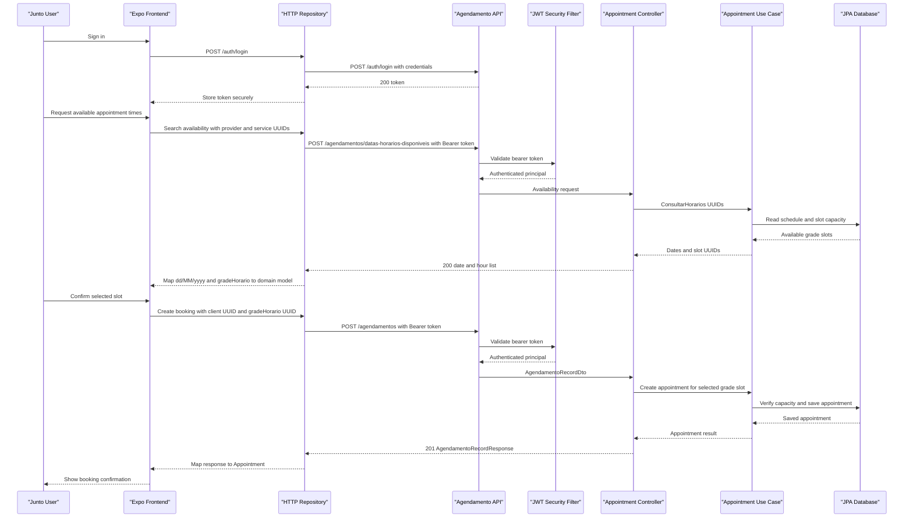

# API & Service Communication Contracts

The Juntô client is an Expo/React Native app with an HTTP adapter scaffold, while Agendamento exposes 21 synchronous REST operations on port 8093. The client and API contracts currently do not align: login exists on the API but not in the client flow, and the client expects profile, service-catalog, slot, and customer-scoped appointment routes that the API does not expose.

## Service Catalog

| Service | Port | Category | Purpose |
| --- | --- | --- | --- |
| Agendamento API (`br.com:agendamento`) | 8093 | API Layer | Authenticated REST API for appointments, schedules, and unavailability; Spring Boot application. |
| Juntô frontend (`junto`) | N/A | Client | Expo/React Native app for viewing a weekly agenda and booking a service; `package.json`, `package-lock.json`, Expo configuration, and dependencies are present. |

There are no discovered Maven submodules, gateway, message broker, or independently deployed backend services. The API uses an H2 in-memory database in its active `test` profile.

## API Endpoints Inventory

All API paths below are relative to `http://<api-host>:8093`. Unless stated otherwise, an `Authorization: Bearer <token>` header is required.

| Service | Method | Path | Request Type | Response Type |
| --- | --- | --- | --- | --- |
| Agendamento API | POST | `/auth/login` | `AuthenticationRecordDTO` (`login`, `password`) | 200 `LoginResponseRecordDtoResponse` (`token`); 400 on invalid credentials |
| Agendamento API | POST | `/auth/register` | `RegisterRecordDTO` (`login`, `password`, `role`) | 200 empty body; roles use `ADMIN` or `USER` |
| Agendamento API | POST | `/agendamentos` | `AgendamentoRecordDto`, including lojista, estabelecimento, servico, cliente, gradeHorario UUIDs and date/time strings | 201 `AgendamentoRecordResponse`; requires JWT |
| Agendamento API | GET | `/agendamentos?statusAgendamento=TODOS` | Optional enum query: `TODOS`, `AGENDADO`, `EFETUADO`, `CANCELADO`, `NAO_COMPARECEU` | 200 list of HATEOAS `AgendamentoItemResponse`; 404 when empty; requires JWT |
| Agendamento API | GET | `/agendamentos/{id}` | UUID path parameter | 200 HATEOAS `AgendamentoItemResponse`; 404 when absent; requires JWT |
| Agendamento API | POST | `/agendamentos/datas-horarios-disponiveis` | JSON `AgendamentoGradeRecordDto` (`lojista`, optional `estabelecimento`, optional `servico`) | 200 list of `{ data, horas: [{ gradeHorario, hora }] }`; date strings are `dd/MM/yyyy`; requires JWT |
| Agendamento API | DELETE | `/agendamentos/{id}` | UUID path parameter | 200 text body; 400 if not found; requires JWT |
| Agendamento API | PUT | `/agendamentos/{id}` | `AgendamentoRecordDto` | 200 `AgendamentoRecordResponse`; date uses `dd/MM/yyyy`, time `HH:mm`; requires JWT |
| Agendamento API | PATCH | `/agendamentos/{id}` | `AgendamentoStatusRecordDto` (`statusAgendamento`) | 200 `AgendamentoRecordResponse`; requires JWT |
| Agendamento API | POST | `/grades` | `GradeRecordDto` | 201 HATEOAS `GradeRecordResponse`; requires JWT |
| Agendamento API | GET | `/grades?statusAgendamento=TODOS` | Optional `statusAgendamento` query parameter | 200 list of HATEOAS `GradeRecordResponse`; 404 when empty; requires JWT |
| Agendamento API | GET | `/grades/{id}` | UUID path parameter | 200 HATEOAS `GradeRecordResponse`; 404 when absent; requires JWT |
| Agendamento API | DELETE | `/grades/{id}` | UUID path parameter | 200 text body or 404; requires JWT |
| Agendamento API | PUT | `/grades/{id}` | `GradeRecordDto` | 200 HATEOAS `GradeRecordResponse` or 404; requires JWT |
| Agendamento API | PATCH | `/grades/{id}` | `GradeRecordDto` | 200 HATEOAS `GradeRecordResponse` or 404; requires JWT |
| Agendamento API | POST | `/indisponibilidades` | `IndisponibilidadeRecordDto` | 201 HATEOAS `IndisponibilidadeResponse`; requires JWT |
| Agendamento API | GET | `/indisponibilidades?tipoIndisponibilidadeDto=TODOS` | Optional `tipoIndisponibilidadeDto` query parameter | 200 list of HATEOAS `IndisponibilidadeResponse`; 404 when empty; requires JWT |
| Agendamento API | GET | `/indisponibilidades/{id}` | UUID path parameter | 200 HATEOAS `IndisponibilidadeResponse`; 404 when absent; requires JWT |
| Agendamento API | DELETE | `/indisponibilidades/{id}` | UUID path parameter | 200 text body or 404; requires JWT |
| Agendamento API | PUT | `/indisponibilidades/{id}` | `IndisponibilidadeRecordDto` | 200 HATEOAS `IndisponibilidadeResponse` or 404; requires JWT |
| Agendamento API | PATCH | `/indisponibilidades/{id}` | `IndisponibilidadeRecordDto` | 200 HATEOAS `IndisponibilidadeResponse` or 404; requires JWT |

There is no API version prefix. The existing client adapter currently calls `GET /me`, `GET /appointments`, `POST /appointments`, `GET /services/{id}`, and `GET /services/{id}/slots`; none of these routes exist on the API.

## Management & Observability Endpoints

| Service | Endpoint | Custom Metrics (if any) |
| --- | --- | --- |
| Agendamento API | `/swagger-ui.html`, `/swagger-ui/**`, `/v3/api-docs/**` | None identified; Swagger/OpenAPI docs are public. |

No Spring Boot Actuator, health endpoint, or custom metrics registration was found.

## DTOs & Contracts

Backend request/response DTOs are Java records (immutable). Authentication uses `AuthenticationRecordDTO` and `RegisterRecordDTO`; appointment creation/update uses `AgendamentoRecordDto`, availability uses `AgendamentoGradeRecordDto`, and appointment summaries use `AgendamentoItemResponse` / `AgendamentoRecordResponse`. Schedule and unavailability contracts use `GradeRecordDto`, `GradeRecordResponse`, `GradeDiaRecordResponse`, `GradeHorarioRecordResponse`, `IndisponibilidadeRecordDto`, and `IndisponibilidadeResponse`. The API's `WebResource<T>` uses Jackson `@JsonUnwrapped`, so wrapped resource content is serialized at the top level alongside HATEOAS `_links`, rather than nested under `content`. Availability data is a plain list of `AgendamentoDataRecordDtoResponse`, containing `data` and `horas`; each hour carries the slot UUID `gradeHorario` and `hora`.

The frontend domain models (`Appointment`, `NewAppointment`, `Service`, `Slot`, `User`) are not wire-compatible with these backend DTOs. The frontend uses ISO dates (`YYYY-MM-DD`), human-readable service identifiers, and a two-state appointment status, while the API uses UUID identifiers, `dd/MM/yyyy` date strings for appointments/availability, and statuses `EFETUADO`, `AGENDADO`, `CANCELADO`, `NAO_COMPARECEU`. An explicit API-to-domain mapper is needed; do not deserialize API JSON directly as frontend entities. Springdoc exposes the generated OpenAPI document at `/v3/api-docs`; no checked-in OpenAPI specification or protobuf/GraphQL schema was found.

## Communication Patterns

- **Client/server:** synchronous JSON over HTTP. The frontend has `HttpClient`, HTTP repositories, and dependency injection; `EXPO_PUBLIC_API_URL` switches the container from mock repositories to HTTP repositories. The HTTP client supports an optional token getter, but `createContainer()` constructs it without one, so authenticated calls do not currently send JWT. Its request helper also always parses a JSON response, which will reject the API's successful empty-body response from `POST /auth/register` unless empty responses are handled.
- **Auth:** `POST /auth/login` returns a JWT with a two-hour expiry. The frontend currently has no login/register screens, token persistence, or authenticated session wiring. All routes except authentication, Swagger, and H2 console require a valid bearer token; therefore “Continuar sem cadastro” cannot use the protected booking API as currently designed. More importantly, public `POST /auth/register` accepts a caller-provided role and the registration use case persists it unchanged; do not expose this flow to clients until the backend forces public registrations to `USER` and restricts `ADMIN` provisioning.
- **Contract gaps blocking the current screens:** there is no `/me` or customer-scoped appointment list; no service catalog/details endpoint; and no date/service slot-search endpoint. The existing availability endpoint instead requires a POST body with the lojista, estabelecimento, and servico UUIDs and returns date-grouped slots. The booking screen currently defaults to the mock id `corte`; the create endpoint requires all five associated UUIDs including `cliente` and `gradeHorario`. The API list endpoint has no date or customer filter and returns all appointments matching a status (or 404 if empty), so it must not be treated as a safe “my appointments” endpoint without backend authorization/filtering changes.
- **Date/slot mapping:** API date values are `dd/MM/yyyy`; frontend state is `YYYY-MM-DD`. The slot UUID returned as `gradeHorario` must be retained when selecting a time and supplied when creating an appointment. Creation requires `horaAgendamento`, but the backend use case chooses the persisted time from the selected grade slot, so that field does not control the saved time. Appointment list responses identify the item as `idAgendamento`; frontend models expect `id`.
- **Resilience/discovery:** no retry policy, timeout configuration, circuit breaker, service discovery, load balancing, or asynchronous messaging was found. The API makes direct repository/database calls inside the service process.
- **Transport/CORS:** no CORS configuration or TLS termination was found in the backend. React Native requests to a local API need a host address reachable from the device (Android emulator commonly uses `10.0.2.2`; a physical device needs the development machine's LAN IP). Expo web is subject to browser CORS and needs an explicit backend allowlist. The development API uses the `test` profile and H2 in-memory storage, so persisted data is lost on restart.
- **Backend behavior to verify before using availability:** `AgendamentoApplicationService.validarGrade` currently throws “Grade está com a data expirada” when today's date is before `dataFimVigor`; this condition appears reversed and can reject an unexpired schedule. Also, grade and unavailability list handlers only populate results for the `TODOS` query value, although the grade handler accepts a status parameter.
- **Recommended integration order:** (1) secure public registration by enforcing the `USER` role, then decide login and guest behavior and store/send bearer tokens securely; (2) align the API contract for service discovery, available slots, and customer-scoped “my appointments” (or provide valid UUIDs and explicit mapping in the frontend); (3) map dates, statuses, HATEOAS response shapes, and empty results, and handle successful empty responses; (4) configure device-reachable API URL and CORS for web; (5) validate the full login → availability → booking → agenda flow.

## Service Technology Matrix

| Service | Web | Data Access | Discovery | Gateway | Actuator | Cache | Metrics |
| --- | --- | --- | --- | --- | --- | --- | --- |
| Agendamento API | Spring MVC / REST | Spring Data JPA, H2 profile | None | None | None | None identified | None identified |
| Juntô frontend | Expo / React Native | HTTP client and in-memory mock repositories | N/A | N/A | N/A | None identified | None identified |

## Service Communication Sequence

<!-- mermaid-checked: every participant uses `participant Id as "Label"`, no \n in aliases/messages/notes, every alt/opt/loop closed by end, no `:` inside any alias -->

